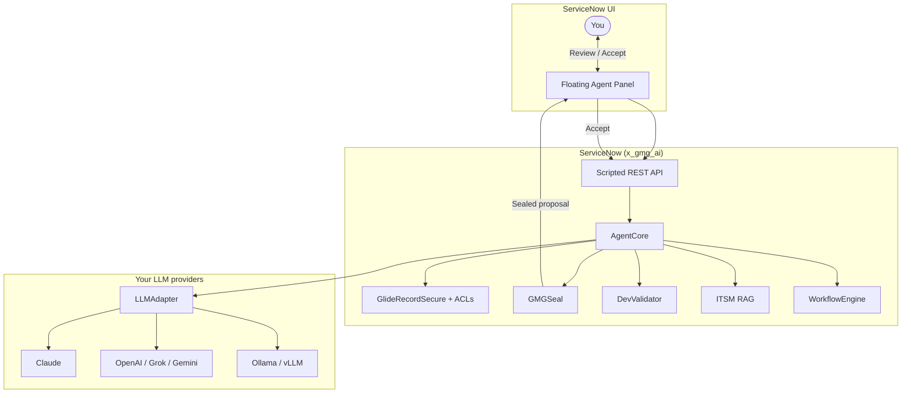

<div align="center">


# Now Pilot for ServiceNow

### The open-source AI agent that **never writes to production without you.**

**From Ticket to Takeoff.** Built natively for ServiceNow. Free. Controllable. Safe.

[](https://github.com/kRamu581/NowPilot)
[](LICENSE)
[](src/test)
[](INSTALL.md)
[](https://github.com/kRamu581/NowPilot/stargazers)
[](https://github.com/kRamu581/NowPilot/network/members)

**Star this repo** if you want a ServiceNow AI agent that respects ACLs, shows you the diff, and waits for **Accept**.

<p align="center">
  <a href="#why-teams-are-switching">Why Now Pilot</a> •
  <a href="#see-it-in-60-seconds">Quick Start</a> •
  <a href="#what-you-get">Features</a> •
  <a href="#architecture">Architecture</a> •
  <a href="#join-the-builders">Contribute</a>
</p>

</div>

---

## The problem everyone hits

Enterprise AI on ServiceNow usually means:

- **Expensive** seat licenses on top of the platform you already pay for  
- **Locked** to one vendor’s models  
- **Scary** autonomous writes with no clear approval path  
- **Opaque** scripts that can freeze an instance with `current.update()` in a Business Rule  

**Now Pilot** is the opposite: open source, multi-model, human-in-the-loop by design.

<p align="center">
  
</p>

---

## Why teams are switching

| Pain with closed GenAI add-ons | What Now Pilot does |
| :--- | :--- |
| $30–$70+/user/month on top of Pro Plus | **$0 platform license** — Apache-2.0. You only pay your LLM tokens. |
| One vendor’s models only | **Claude, GPT-4o, Grok, Gemini, DeepSeek, Ollama, vLLM** — route how you want. |
| Model writes straight to tables | **0% unapproved writes.** Every change is a sealed proposal. You click **Accept**. |
| Generic code that breaks the platform | **DevValidator** blocks `current.update()`, `eval()`, and other instance-killers. |
| Can’t try without a full instance | **`node local_runner.js`** — full mock UI in under 60 seconds. |

---

## What you get


### 💬 Context-aware chat that follows you
Floating panel across forms, lists, and Next Experience. Reads the open record via `g_form` — no bulk data dump.

### 🔍 ITSM intelligence (explainable, not black-box)
Similar resolved incidents, published KB only, citation checks so the model can’t invent ticket numbers unnoticed.

### 💻 Dev Assistant with platform safety rails
Business Rules, Script Includes, Client Scripts, UI Policies — generated and reviewed with **static checks** that forbid dangerous patterns.

### ⚡ Agentic workflows with pause / approve / resume
Multi-step plans run reads automatically; writes become proposal cards. Reload-safe. No duplicate applies.

### 🛡️ GMGSeal — cryptographic proposal integrity
HMAC-SHA256 seals, stale-record detection (`sys_mod_count`), replay protection. The model never touches production tables directly.

### 🌐 Your models, your keys
OmniRoute, OpenRouter, Anthropic, OpenAI, **Google Gemini**, local Ollama/vLLM — same agent, different backends.

---

## See it in 60 seconds

No ServiceNow instance required.

```bash
git clone https://github.com/kRamu581/NowPilot.git
cd NowPilot
node local_runner.js
# → http://localhost:3000
```

Click the **Now Pilot** launcher. Work a mock incident. Feel the approval flow.

**Deploy to an instance?** → [INSTALL.md](INSTALL.md) (update sets + provider setup).

**Gemini in one line:** type `openai_compatible`, base URL `https://generativelanguage.googleapis.com/v1beta/openai`, model `gemini-2.0-flash`, your AI Studio key.

---

## Architecture



Human always has the last click.

---

## Security (non-negotiable)

- **No unapproved DB writes** — proposals only  
- **ACLs enforced** — `GlideRecordSecure`  
- **SSRF locked down** — no private/metadata targets  
- **PII redaction** on outbound LLM traffic  
- **Audit + correlation IDs** on every request  

Details: [SECURITY.md](SECURITY.md)

---

## Tests you can run offline

**184/184** automated tests. No instance. No network.

```bash
node src/test/test_omniroute.js
node src/test/test_dev_assistant.js
node src/test/test_itsm_intelligence.js
node src/test/test_workflow_automation.js
node src/test/test_production_readiness.js
```

---

## Join the builders

This project moves when people use it and break it on real instances.

**High-impact ways to contribute:**

1. New LLM providers / gateway quirks  
2. Stronger DevValidator rules (Flow, IntegrationHub, Scripted REST)  
3. Better ITSM ranking (BM25, CMDB graph)  
4. Real-world workflow templates (change, access, HR)  
5. UI accessibility & keyboard flows  
6. Live install reports on new ServiceNow releases  

```bash
git clone https://github.com/kRamu581/NowPilot.git
cd NowPilot
git checkout -b feature/your-idea
node local_runner.js
# …ship it…
git commit -s -m "feat: your change"
# open a PR against main
```

Full guide: [CONTRIBUTING.md](CONTRIBUTING.md)  
DCO sign-off (`-s`) required.

---

## Project layout

```
NowPilot/
├── README.md, INSTALL.md, FEATURES.md, SECURITY.md, CONTRIBUTING.md
├── local_runner.js          # local simulator (port 3000)
├── src/
│   ├── global/              # UI panel
│   ├── scoped/              # AgentCore, LLMAdapter, DevValidator, workflows…
│   ├── assets/              # logos, favicons
│   └── test/                # 184 offline tests
└── update_sets/             # ServiceNow XML install packages
```

---

## Acknowledgments

Portions of documentation and development collaboration were supported by **[Grok](https://x.ai)** (xAI). Final decisions and merges stay with the maintainer.

> **Disclaimer:** Now Pilot is an independent open-source project developed and extended by **Kanam Ramu**, based on the GMG AI Agent foundation (Apache-2.0). GMG Technology LLC is not involved in the development, maintenance, or endorsement of Now Pilot. ServiceNow and related marks are trademarks of ServiceNow, Inc. Anthropic, OpenAI, and Google marks belong to their respective owners. No commercial affiliation.

---

## License

**Apache License 2.0** — see [LICENSE](LICENSE).

```
Copyright 2026 GMG Technology LLC
Developed and extended by Kanam Ramu
```

---

<div align="center">

**If this is the ServiceNow AI agent you wished existed — star the repo and open an issue.**

[](https://github.com/kRamu581/NowPilot)

**Now Pilot** · Built for people who still want the last click · Open source for enterprise IT

</div>
