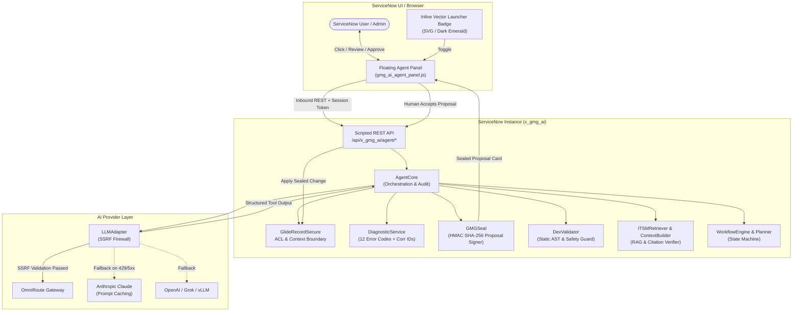

<div align="center">


# Now Pilot for ServiceNow

**The Autonomous, Sovereign, and Safe AI Control Plane for the ServiceNow Platform.**

[](https://github.com/kRamu581/nowpilot-servicenow)
[](LICENSE)
[](src/test)
[](INSTALL.md)
[](src)
[](https://github.com/kRamu581)

<p align="center">
  <a href="#overview">Overview</a> •
  <a href="#why-now-pilot">Why Now Pilot?</a> •
  <a href="#comparison-now-pilot-vs-now-assist">Now Pilot vs. Now Assist</a> •
  <a href="#core-capabilities">Capabilities</a> •
  <a href="#architecture">Architecture</a> •
  <a href="#quick-start">Quick Start</a> •
  <a href="#security--governance">Security & Governance</a> •
  <a href="#contributing--open-source-community">Contributing</a> •
  <a href="#automated-test-suite">Tests (184/184)</a> •
  <a href="LICENSE">License</a>
</p>


</div>

---

## Overview

**Now Pilot for ServiceNow** is a platform-native, sovereign AI assistant and orchestration control plane built directly into ServiceNow. Operating seamlessly inside UI16 classic forms, lists, Service Operations Workspace, and Next Experience / Polaris iframes, Now Pilot unites state-of-the-art LLMs with enterprise ServiceNow governance:

- 🔒 **0% Unapproved Database Writes**: The model never touches your production tables directly. Every proposed change (incident update, state change, script edit) is serialized as a cryptographically sealed proposal (`GMGSeal`) requiring explicit human approval.
- 🛡️ **Native ACL Boundaries**: All record lookups and searches evaluate strictly through `GlideRecordSecure`, enforcing the caller's actual ServiceNow Access Control Lists (ACLs).
- 🌐 **Multi-Gateway Freedom**: Connect seamlessly to **OmniRoute Gateway**, **OpenRouter**, **Anthropic Claude** (with prompt caching), **OpenAI** (GPT-4o), or **local private LLMs** (vLLM, Ollama, LM Studio) with automated secondary failover.
- 🔍 **Deterministic ITSM Intelligence**: Explainable multi-factor similarity retrieval (TF-IDF + category/CI match), active published Knowledge Base search, grounded recommendations, and anti-hallucination citation verification.
- 💻 **ServiceNow Development Assistant**: Generates, reviews, and debugs Business Rules, Script Includes, Client Scripts, and UI Policies with static AST analysis (`DevValidator`) that actively forbids dangerous patterns like `current.update()` and `eval()`.
- ⚡ **Agentic Multi-Step Workflows**: Decomposes natural language requests into structured execution plans, runs permitted read tools, pauses safely for approvals, and safely handles resumes without duplicate writes.
- 🚀 **Zero-Dependency Local Simulator**: Test the entire frontend panel, REST endpoints, and mock incident context locally on your machine with `node local_runner.js` in under 60 seconds without needing a live ServiceNow instance.

---

## Why Now Pilot?

ServiceNow instances run mission-critical enterprise workloads—incident response, customer service, change management, and infrastructure automation. However, traditional enterprise AI options present difficult trade-offs:

| Problem with Closed AI Add-ons | How Now Pilot Solves It |
| :--- | :--- |
| **Steep Per-Seat License Fees**: Enterprise GenAI add-ons typically add \$30–\$70+ per user/month on expensive *Pro Plus* tiers. | **\$0 Platform License Cost**: Free, fully open-source core under Apache-2.0. Pay only wholesale token rates to your chosen LLM provider. |
| **Vendor & Model Lock-In**: Restricted to vendor-hosted models with pre-allocated consumption units. | **Complete Multi-Provider Freedom**: Route to Claude, GPT-4o, Grok, DeepSeek, or private self-hosted Ollama/vLLM instances via OmniRoute. |
| **Unpredictable AI Overwrites**: Autonomous LLMs writing directly to production records without clear diff previews. | **Deterministic GMGSeal Verification**: HMAC-SHA256 sealed proposals with visual field diffs and stale-record conflict detection. |
| **Bad Script Generation**: Generic AI models generating `current.update()` in Business Rules, triggering infinite recursion loops. | **Static AST Safety Guard (`DevValidator`)**: 8 platform-specific static analysis rules block unsafe scripts before they can be staged. |
| **Zero Offline Visibility**: Closed SaaS solutions cannot be tested, simulated, or integrated into local CI/CD pipelines. | **Local Interactive Simulator**: Run the full mock environment offline with `node local_runner.js` and 184 automated tests. |

---
<p align="center">
 

</p>
---

## Core Capabilities

Now Pilot features four dedicated operational modes accessible via the top mode switcher:


### 1. 💬 Context-Aware Chat
- **Follows You Across Frames**: The lightweight floating panel rendered in the top-level window follows you across forms, list views, and Next Experience iframe navigations.
- **Dynamic Context**: Automatically reads current table name, `sys_id`, and active form fields via `g_form` without sending sensitive unneeded records.
- **Cross-User Isolation**: Browser session storage is scoped strictly to `g_user.userID`. Switching user logins in the same browser tab immediately purges other users' cached state.

### 2. 🔍 ITSM Intelligence & RAG
- **Explainable Incident Similarity**: Evaluates historical resolved tickets using multi-factor scoring (text relevance + category match + Configuration Item alignment) rather than black-box embeddings.
- **Knowledge Base Retrieval**: Discovers active, published articles; strictly filters out draft, expired, or retired articles under caller user criteria.
- **Citation Guard & Anti-Hallucination**: Cross-references citations in model responses against the retrieved evidence. If the model cites an incident (e.g. `INC0010999`) not in the retrieved dataset, Now Pilot flags an explicit red **Citation Warning** banner.

### 3. 💻 Dev Assistant & Static Validation (`DevValidator`)
- **Artifact Generation**: Generates Business Rules (before, after, async), Script Includes (Class prototype & AbstractAjaxProcessor), Client Scripts (with `isLoading` guards), and UI Policies.
- **Static Platform Safety**:
  - Strictly blocks `current.update()` in Business Rules to prevent infinite recursive loop freezes.
  - Flags dangerous functions: `eval()`, `new Function()`, and dynamic string timeouts.
  - Sanitizes encoded queries to prevent injection vulnerabilities.
- **8-Point Architectural Review**: Analyzes existing scripts against platform execution context, performance bottlenecks, and security standards.

### 4. ⚡ Agentic Workflow Automation
- **Autonomous Multi-Step Planning (`WorkflowPlanner`)**: Accepts user goals (e.g., *"Investigate INC0010001, find matching resolved tickets, and propose a resolution note"*) and decomposes them into an ordered, executable JSON plan.
- **Controlled Tool Execution (`WorkflowEngine`)**:
  - Permitted read tools (`record_read`, `record_search`, `kb_search`, `code_read`) run automatically.
  - Write tools (`record_create`, `record_update`, `kb_create`) stage proposed changes as pending cards.
- **Safe Pause & Resume**: The workflow enters `waiting_approval` status until the user clicks **Accept**. If interrupted or reloaded, resume logic detects already-applied proposals and skips re-execution.

### 5. 🛡️ Cryptographic Proposal Integrity (`GMGSeal`)
- **HMAC SHA-256 Seal**: Proposals carry a cryptographic tamper seal. Any client-side parameter alteration invalidates the seal.
- **Stale Record Protection**: Before applying an approved proposal, the engine checks `sys_mod_count` and `sys_updated_on`. If another admin edited the record in the background, the transaction is rejected (`STALE_CONFLICT`).
- **Replay Protection**: Applying an already-applied proposal returns `HTTP 409 Conflict`.

---

## Architecture



---

## Quick Start

You can test Now Pilot immediately via the local simulator or deploy to a ServiceNow instance in 2 minutes:

### Option 1: Instant Local Sandbox (1 Minute)

No ServiceNow instance or cloud account required:

```bash
# 1. Clone the repository
git clone https://github.com/kRamu581/nowpilot-servicenow.git
cd nowpilot-servicenow

# 2. Start the local simulation server
node local_runner.js

# 3. Open your browser
# http://localhost:3000
```
Click the circular **Now Pilot** launcher button at the bottom-right corner to interact with mock incident `INC0010001`!

---

### Option 2: Deploying to a ServiceNow Instance

#### System Requirements
- ServiceNow **Vancouver**, **Washington DC**, **Xanadu**, or **Brazil** (Patch 7+).
- System Administrator privileges (`admin` role).
- Always install and test on a **sub-production (dev/test)** instance first.

#### Step 1: Import Update Sets in Order
1. Go to **System Update Sets > Retrieved Update Sets**.
2. Click **Import Update Set from XML**.
3. Upload and commit the **Global Update Set** first:
   - File: [`update_sets/now_pilot_global.xml`](update_sets/now_pilot_global.xml)
   - Click **Preview Update Set** &rarr; Verify 0 errors &rarr; Click **Commit Update Set**.
4. Upload and commit the **Scoped Update Set** second:
   - File: [`update_sets/now_pilot_scoped.xml`](update_sets/now_pilot_scoped.xml)
   - Click **Preview Update Set** &rarr; Verify 0 errors &rarr; Click **Commit Update Set**.

#### Step 2: Configure AI Providers
In Filter Navigator, type `x_gmg_ai_provider.list` and click **New**:
- **OmniRoute / OpenRouter**:
  - Name: `OmniRoute Gateway`
  - Type: `omniroute` *(or `openai_compatible`)*
  - Base URL: `https://openrouter.ai/api/v1` *(or your custom gateway URL)*
  - Model: `openai/gpt-4o-mini`
  - API Key: Encrypted secret key
  - Is default: **Checked `[x]`**
  - Active: **Checked `[x]`**

#### Step 3: Flush Cache & Refresh
1. Navigate to: `https://your-instance.service-now.com/cache.do`
2. Open any Incident and press **`Ctrl + F5`**.

---

## Contributing & Open Source Community

Now Pilot is an **open-source, community-driven project**. We actively invite developers, ServiceNow administrators, platform architects, and AI researchers from around the world to contribute!

```
┌────────────────────────────────────────────────────────────────────────┐
│                   HOW YOU CAN CONTRIBUTE TO NOW PILOT                  │
├────────────────────────────────────────────────────────────────────────┤
│ 1. 🤖 New LLM Providers      Add support for DeepSeek, AWS Bedrock,    │
│                              Azure OpenAI, or Ollama templates         │
│ 2. 🛡️ DevValidator Rules     Add AST rules for Flow Designer,          │
│                              IntegrationHub, and Scripted REST APIs    │
│ 3. 🔍 ITSM Algorithms        Improve BM25/TF-IDF scoring, CMDB graph   │
│                              traversals, and Major Incident playbooks  │
│ 4. ⚡ Agentic Workflows      Contribute pre-built multi-step workflows │
│                              for Change Reviews, Access, and HR Cases  │
│ 5. 🧪 Testing & CI/CD        Add test fixtures for upcoming ServiceNow │
│                              releases and edge-case security checks    │
│ 6. 🎨 UI & Accessibility     Enhance panel accessibility, themes, and  │
│                              keyboard navigation shortcuts             │
└────────────────────────────────────────────────────────────────────────┘
```

### Contributor Workflow (5 Easy Steps)

1. **Fork & Clone**:
   ```bash
   git clone https://github.com/kRamu581/nowpilot-servicenow.git
   cd nowpilot-servicenow
   ```
2. **Create a Feature Branch**:
   ```bash
   git checkout -b feature/my-new-capability
   ```
3. **Develop & Test Locally**:
   ```bash
   # Run the local simulator
   node local_runner.js
   
   # Run all 184 verification tests
   node src/test/test_production_readiness.js
   ```
4. **Sign Off Your Commits** (DCO):
   ```bash
   git commit -s -m "feat(provider): add AWS Bedrock adapter"
   ```
5. **Open a Pull Request**:
   - Push your branch to GitHub and open a PR against `main`.
   - Ensure all automated tests pass with 100% green status.

For full guidelines on coding conventions, update set synchronization, and our threat model, read [CONTRIBUTING.md](CONTRIBUTING.md).

---

## Automated Test Suite

Now Pilot features a 100% offline, zero-network-dependency automated test harness covering all critical subsystems:

| Test Suite | File | Tests | Focus Area |
| :--- | :--- | :---: | :--- |
| **OmniRoute Integration** | [`src/test/test_omniroute.js`](src/test/test_omniroute.js) | 13 | SSRF defense, model allowlist, fallback, token accounting |
| **Dev Assistant** | [`src/test/test_dev_assistant.js`](src/test/test_dev_assistant.js) | 20 | Code generation, static AST validation, `current.update` guard |
| **ITSM Intelligence** | [`src/test/test_itsm_intelligence.js`](src/test/test_itsm_intelligence.js) | 22 | Incident similarity, KB search, citation verification, prompt safety |
| **Workflow Automation** | [`src/test/test_workflow_automation.js`](src/test/test_workflow_automation.js) | 22 | Goal planning, tool execution, pause/resume, lifecycle invariants |
| **Production Readiness & Hardening** | [`src/test/test_production_readiness.js`](src/test/test_production_readiness.js) | 107 | Diagnostics, correlation IDs, retry backoff with jitter, table validation, close codes, outbound PII redaction, manifest consistency |
| **Total** | | **184** | **100% Pass Rate** |

### Run Tests Locally
```bash
# Run individual test suites
node src/test/test_omniroute.js
node src/test/test_dev_assistant.js
node src/test/test_itsm_intelligence.js
node src/test/test_workflow_automation.js
node src/test/test_production_readiness.js

# Or run all 184 tests in one command:
node -e "['test_omniroute.js','test_dev_assistant.js','test_itsm_intelligence.js','test_workflow_automation.js','test_production_readiness.js'].forEach(f=>require('./src/test/'+f));"
```

---

## Security & Governance

Now Pilot is designed to satisfy stringent enterprise information security standards:

1. **SSRF Mitigation**: Outbound HTTP calls reject private subnets (RFC 1918), carrier-grade NAT, and cloud metadata services (`169.254.169.254`). Remote endpoints require HTTPS.
2. **Context Sandboxing**: Record text from tickets or Knowledge Base articles is tagged as untrusted input and sandboxed with strict boundary prompts to mitigate prompt injection.
3. **Audit Logging & Correlation IDs**: Every inbound request is assigned an authoritative server correlation ID (`corr_<timestamp>_<randomHex>`). Structured audit events are recorded in `x_gmg_ai_log` across all key state boundaries.
4. **Secret & PII Scrubbing**: API keys, passwords, bearer tokens, emails, phone numbers, and SSNs are systematically scrubbed before any outbound LLM call or diagnostic record is saved.

For complete architectural details and disclosure protocols, see [SECURITY.md](SECURITY.md).

---

## Project Structure

```
nowpilot-servicenow/
├── README.md                      # Comprehensive project documentation
├── CONTRIBUTING.md                # Community contribution guidelines & standards
├── SECURITY.md                    # Threat model, SSRF defense & vulnerability disclosure
├── INSTALL.md                     # Step-by-step ServiceNow installation guide
├── FEATURES.md                    # Detailed capability breakdown across versions
├── DATA_NOTICE.md                 # Privacy and network egress disclosure
├── TRADEMARKS.md                  # Trademark notices and brand attributions
├── LICENSE                        # Apache License 2.0 with copyright attribution
├── NOTICE                         # Formal Apache notice file
├── SHA256SUMS                     # SHA-256 verification hashes for XML update sets
├── local_runner.js                # Zero-dependency local simulation server (port 3000)
├── landing.html                   # Marketing / landing page
├── index.html                     # Local simulator shell
├── favicon.ico / favicon.svg
├── src/
│   ├── assets/                    # Logos, favicons, mockup images
│   ├── global/                    # Global UI Scripts (panel + applier)
│   ├── scoped/                    # Scoped Script Includes (AgentCore, etc.)
│   └── test/                      # 184 automated offline tests
└── update_sets/
    ├── now_pilot_global.xml       # Global update set (UI script + applier)
    ├── now_pilot_scoped.xml       # Scoped application update set (330 updates)
    ├── gmg_ai_agent_global.xml    # Global update set (alias)
    └── gmg_ai_agent_scoped.xml    # Scoped application update set (alias)
```

---

## Acknowledgments

Portions of this project's documentation, structure review, and ongoing development assistance were supported by **[Grok](https://x.ai)**, built by **xAI**.

Grok is used as a collaborative AI coding and documentation partner. All final decisions, security reviews, and production merges remain under human control by the project maintainer.

We appreciate transparent AI-assisted open-source development.

> **Disclaimer & Attribution Notice:** **Now Pilot for ServiceNow** is an independent open-source project **developed and extended by Kanam Ramu**, based on the GMG AI Agent open-source foundation originally released by GMG Technology LLC under the Apache License 2.0. **GMG Technology LLC is not involved in the development, maintenance, sponsorship, or endorsement of Now Pilot.** ServiceNow, Now Platform, Next Experience, and Polaris are registered trademarks of ServiceNow, Inc. Anthropic and Claude are trademarks of Anthropic PBC. OpenAI is a trademark of OpenAI, Inc. This project has no commercial affiliation with ServiceNow, Inc. or GMG Technology LLC.

---

## License

This project is licensed under the **Apache License, Version 2.0**. See the [LICENSE](LICENSE) file for the full text.

```
Copyright 2026 GMG Technology LLC
Developed and extended by Kanam Ramu

Licensed under the Apache License, Version 2.0 (the "License");
you may not use this file except in compliance with the License.
You may obtain a copy of the License at

    http://www.apache.org/licenses/LICENSE-2.0
```

---

<div align="center">
  <b>Now Pilot for ServiceNow</b> &bull; Built by Kanam Ramu &bull; Open Source for Enterprise IT
</div>
