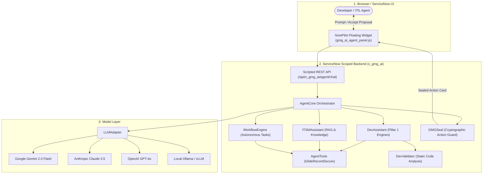

<div align="center">


# Now Pilot for ServiceNow v2.0

### The open-source AI agent that **never writes to production without you.**

**From Ticket to Takeoff.** Built natively for ServiceNow. Free. Controllable. Safe.

[](https://github.com/kRamu581/NowPilot)
[](LICENSE)
[](src/test)
[](INSTALL.md)
[](https://github.com/kRamu581/NowPilot/stargazers)
[](https://github.com/kRamu581/NowPilot/network/members)

**Star this repo** if you want a ServiceNow AI agent that respects ACLs, shows you the diff, slashes backlogs, and waits for **Accept**.

<p align="center">
  <a href="#whats-new-in-v20">What's New in v2.0</a> •
  <a href="#why-teams-are-switching">Why Now Pilot</a> •
  <a href="#see-it-in-60-seconds">Quick Start</a> •
  <a href="#core-capabilities">Features</a> •
  <a href="#automated-test-suites-224224-passing">Tests</a> •
  <a href="#architecture">Architecture</a>
</p>

</div>

---

## 🚀 What's New in v2.0

Version 2.0 introduces **Pillar 1: Slashing the Backlog & Bridging the Talent Shortage**, directly addressing the enterprise failure points where platform teams get stuck on legacy backlogs, painful upgrades, and junior coding debt.

### 1. 🏛️ Backlog Story Decomposer (`DevAssistant.StoryDecomposer`)
Turns vague business stories, enhancements, or Jira requests into production-grade Certified Technical Architect (CTA) blueprints before touching code:
- **Out-of-the-Box (OOTB) First:** Enforces platform longevity by recommending OOTB UI Policies over Client Scripts and Flow Designer over hardcoded Business Rule notifications.
- **Complete Component Decomposition:** Automatically itemizes every needed artifact: UI Policies, Flows, Before Business Rules, Script Includes, and ACLs.
- **Agile Governance:** Calculates Fibonacci story points (`1, 2, 3, 5, 8, 13`), complexity rankings (`Low`, `Medium`, `High`), risk factors, and Given-When-Then BDD acceptance criteria.

### 2. 🧪 Automated Test Framework (ATF) Engine (`DevAssistant.ATFGenerator`)
Upgrades stall when manual regression testing takes weeks. NowPilot eliminates the testing backlog by auto-generating production-ready ATF suites:
- **Form Steps:** Sequential generation of `impersonate`, `open_a_new_form`, `set_field_values`, `field_state_validation` (mandatory & read-only enforcement), and `submit_a_form`.
- **Self-Cleaning Jasmine Server Scripts:** Complete Jasmine BDD assertion scripts for native ATF step *Run Server Side Script* with fixture creation (`beforeEach`), assertions (`it`), and zero-residual database teardown (`afterEach`).

### 3. 🛠️ Senior Architect Code Refactorer (`DevAssistant.ArchitectRefactorer`)
Bridges the talent gap by acting as an automated Senior Architect reviewing and rewriting junior code:
- **Removes `current.update()` Recursion:** Eliminates recursive updates in `before` Business Rules that cause stack overflows and database transaction locks.
- **Synchronous Client `GlideRecord` → Asynchronous `GlideAjax`:** Automatically replaces UI-freezing client scripts with `GlideAjax` (`getXMLAnswer`) and **generates the companion server-side `Script Include`** extending `global.AbstractAjaxProcessor`.
- **Unbounded Query Guards:** Injects defensive `setLimit(500)` before `gr.query()` to prevent heap memory exhaustion.
- **Sys_ID Externalization:** Replaces hardcoded 32-character hexadecimal sys_ids with dynamic `gs.getProperty` lookups.
- **N+1 Loop Detection:** Flags `new GlideRecord` queries inside iteration loops.

### 4. 🎨 Otto UI Design System
- Sleek floating sidecar widget with emerald branding tokens and responsive layout.
- Native, frictionless text entry with support for multi-line inputs and shortcut prompts.
- Interactive proposal cards with syntax-highlighted code diffs and 1-click **Accept / Reject**.

### 5. 🤖 Google Gemini 2.0 Flash Native Integration
- Built-in provider support for `gemini-2.0-flash` alongside Claude 3.5 Sonnet, GPT-4o, and local models via OmniRoute.

---

## The problem everyone hits

Enterprise AI on ServiceNow usually means:

- **Expensive** seat licenses on top of the platform you already pay for  
- **Locked** to one vendor’s models  
- **Scary** autonomous writes with no clear approval path  
- **Opaque** scripts that freeze instances with `current.update()` in Business Rules  

**Now Pilot** is the opposite: open source, multi-model, human-in-the-loop by design.

---

## Why teams are switching

| Pain with closed GenAI add-ons | What Now Pilot does |
| :--- | :--- |
| $30–$70+/user/month on top of Pro Plus | **$0 platform license** — Apache-2.0. You only pay your LLM tokens. |
| One vendor’s models only | **Google Gemini 2.0 Flash, Claude, GPT-4o, Grok, DeepSeek, Ollama, vLLM** — route how you want. |
| Model writes straight to tables | **0% unapproved writes.** Every change is a sealed proposal. You click **Accept**. |
| Junior code that breaks the platform | **DevValidator & ArchitectRefactorer** block and fix `current.update()`, `eval()`, and sync GlideRecord. |
| Testing takes weeks and stalls upgrades | **ATF Generator** produces automated form validation steps and Jasmine server assertions. |
| Can’t try without a full instance | **`node local_runner.js`** — full mock UI in under 60 seconds. |

---

## Core Capabilities

### 💬 Context-Aware Chat
Floating panel across forms, lists, and Next Experience. Automatically reads active record context (`g_form`, `table`, `sys_id`) without manual copy-pasting.

### 🔍 ITSM Intelligence
Correlates open tickets with historically resolved incidents and published Knowledge Base articles. Enforces citation integrity to eliminate AI hallucinations.

### 💻 Dev Assistant & Code Generation
Produces production-grade ServiceNow scripts:
- Business Rules (`before`, `after`, `async`)
- Script Includes (standard and client-callable `AbstractAjaxProcessor`)
- Client Scripts (`onLoad`, `onChange`, `onSubmit`)
- UI Policies & UI Actions
- Scripted REST APIs & Service Portal widgets

### ⚡ Autonomous Workflows with Pause / Approve / Resume
Multi-step workflow plans execute read operations automatically, pausing whenever a state change or write is needed to generate an action proposal card.

### 🛡️ GMGSeal — Cryptographic Proposal Integrity
Every proposed modification is protected by HMAC-SHA256 seals, `sys_mod_count` stale-record checks, and replay prevention. The AI never commits directly to tables without human confirmation.

---

## See it in 60 seconds

No ServiceNow instance required to test the interface and developer engines:

```bash
git clone https://github.com/kRamu581/NowPilot.git
cd NowPilot
node local_runner.js
# → Open http://localhost:3000/incident.do
```

Click the floating **Now Pilot** launcher at the bottom-right. Work a mock incident, decompose a backlog story, or refactor code.

### Deploy on a ServiceNow Instance

Follow the 11-step walkthrough in **→ [INSTALL.md](INSTALL.md)**:

1. Import **`update_sets/now_pilot_global.xml`** → Preview → Commit
2. Import **`update_sets/now_pilot_scoped.xml`** → Preview → Commit
3. Assign role `x_gmg_ai.user` to your user account
4. Add an AI provider in `x_gmg_ai_provider.list` (e.g. Gemini, OpenAI, Claude, or OpenRouter)
5. Open an Incident form and click the launcher

**Gemini Quick Setup:**
- Type: `gemini` (or `openai_compatible`)
- Model: `gemini-2.0-flash`
- Base URL: `https://generativelanguage.googleapis.com/v1beta/openai`
- API Key: Key from [Google AI Studio](https://aistudio.google.com/apikey)

---

## 🧪 Automated Test Suites (224/224 Passing)

Every release of NowPilot is rigorously validated by **224 automated unit tests across 8 suites** that execute offline with zero network dependencies:

| Suite # | Test Suite | File | Tests | Status |
|:---:|---|---|:---:|:---:|
| 1 | **Responsive Layout** | `src/test/test_responsive_layout.js` | 7 | ✅ Passed |
| 2 | **Otto UI Redesign** | `src/test/test_otto_ui.js` | 7 | ✅ Passed |
| 3 | **Production Readiness** | `src/test/test_production_readiness.js` | 107 | ✅ Passed |
| 4 | **Dev Assistant** | `src/test/test_dev_assistant.js` | 20 | ✅ Passed |
| 5 | **ITSM Intelligence** | `src/test/test_itsm_intelligence.js` | 22 | ✅ Passed |
| 6 | **OmniRoute Multi-Model** | `src/test/test_omniroute.js` | 13 | ✅ Passed |
| 7 | **Workflow Automation** | `src/test/test_workflow_automation.js` | 22 | ✅ Passed |
| 8 | **Pillar 1 Backlog Uplift** | `src/test/test_pillar1_backlog_uplift.js` | 26 | ✅ Passed |
| **Total** | **All Test Suites** | `node src/test/run_all_tests.js` | **224** | **100% Passed (0 Failed)** |

### Run Tests Locally:

```bash
# Run all 224 functional test suites
node src/test/run_all_tests.js

# Verify exact byte-for-byte parity between source code and update set XMLs
node src/test/audit_xml.js

# Verify ServiceNow Retrieved Update Set XML syntax
node src/test/verify_servicenow_format.js
```

---

## Architecture



---

## Security (Non-Negotiable)

- **Zero Unapproved Writes:** Proposals only. Database writes occur only upon human confirmation.
- **ACL Enforcement:** All database access routes through `GlideRecordSecure`.
- **SSRF Hardening:** Private, metadata, and link-local IP addresses are blocked.
- **PII Redaction:** Sensitive credentials and system information are stripped from outbound traffic.
- **Audit Trails:** Unique correlation IDs and execution telemetry are recorded for compliance.

Details: [SECURITY.md](SECURITY.md)

---

## Project Layout

```
NowPilot/
├── README.md, INSTALL.md, FEATURES.md, SECURITY.md, CONTRIBUTING.md
├── local_runner.js                       # Local ServiceNow simulator (port 3000)
├── SHA256SUMS                            # Cryptographic checksums of packaged XMLs
├── update_sets/                          # Canonical ServiceNow Update Sets
│   ├── now_pilot_global.xml              # Global UI panel & applier
│   └── now_pilot_scoped.xml              # Scoped application backend (x_gmg_ai)
├── src/
│   ├── global/                           # Global UI script (gmg_ai_agent_panel.js)
│   ├── scoped/                           # AgentCore, DevAssistant, DevValidator, LLMAdapter...
│   ├── assets/                           # Vector logos and favicons
│   └── test/                             # 224 unit tests across 8 suites
└── scripts/
    └── rebuild_global_xml.py             # Packaging sync utility
```

---

## License

**Apache License 2.0** — see [LICENSE](LICENSE).

```
Copyright 2026 GMG Technology LLC
Developed and extended by Kanam Ramu
```

---

<div align="center">

**If this is the ServiceNow AI agent you wished existed — star the repo!**

[](https://github.com/kRamu581/NowPilot)

**Now Pilot** · Built for people who still want the last click · Open source for enterprise IT

</div>
